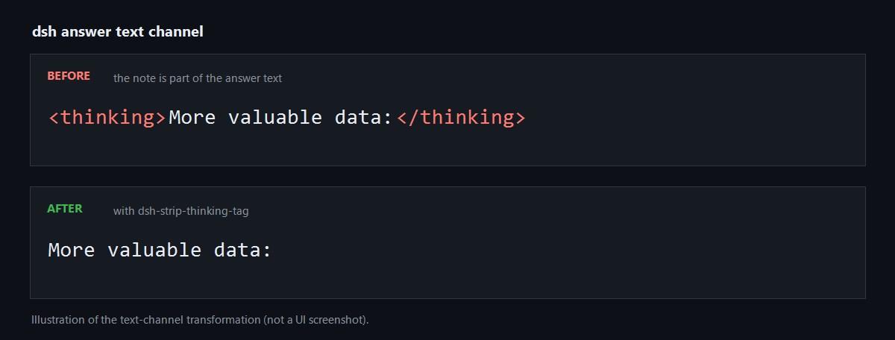

# dsh-strip-thinking-tag

A [DeepSeek Harness](https://github.com/deepseek-ai/deepseek-harness) (`dsh`) plugin that removes a `<thinking>…</thinking>` note a model sometimes writes into the **answer** text channel, so it never reaches the chat or the stored session log.

English | [中文](README.zh.md)



<sub>Illustration of the text-channel transformation — not a UI screenshot.</sub>

## The problem

`dsh` keeps reasoning and answer text in two separate channels. A well-behaved model streams its chain of thought as `reasoning` blocks, which the UI shows in a collapsed disclosure and never mixes into the reply.

Occasionally a model puts part of that reasoning into the ordinary answer text instead:

```json
{"type":"text","text":"<thinking>Let me read the spec doc first.</thinking>Here is the answer…"}
```

Nothing strips it, so the reader sees the raw tag. The same session usually contains hundreds of perfectly normal `reasoning` blocks, so the leak looks random — it is intermittent model behaviour, not a configuration problem. No `llm-pi-ai` compatibility flag changes it: `thinkingFormat` decides how a request *asks* for reasoning, and `requiresThinkingAsText` decides how past reasoning is *replayed*; neither touches the text a model sends back.

## What it does

The plugin listens on the `llm/stream` waterfall and rewrites **text** blocks only:

- A text block that begins with `<thinking>` — leading whitespace allowed — has that span removed, content included.
- An unclosed `<thinking>` at the end of a block drops the rest of that block.
- Everything else passes through untouched. The `reasoning` channel is never modified, and neither are tool calls, usage or finish chunks.

Because it sits on the model-output seam, the note is gone from the live stream *and* from what gets written to the session log.

### Deliberately narrow

Only a **block-initial** match is stripped. A tag in the middle of a sentence — an answer that is discussing the tag itself, for example — is left alone. Every leak observed in practice begins the block, so this rule removes the nuisance without touching prose that legitimately mentions the tag.

## Install

```sh
dsh plugin --profile <your-profile> add dsh-strip-thinking-tag
```

The package declares a `dsh.bundle` manifest, so installing it mounts its patch layer. If your profile does not hot-reload patches, restart the host afterwards.

Installing from this repository directly also works:

```sh
dsh plugin --profile <your-profile> add github:hz13332/dsh-strip-thinking-tag
```

## Scope and safety

- No dependencies, and no file or network access of its own — it only transforms the stream it is handed.
- The request sent to the provider is not modified.
- Roughly 110 lines of code, in one file.

## Tests

```sh
node test.mjs
```

15 assertions. They cover a tag split across stream deltas (`<thin` + `king>`), the unclosed tag, the leading-whitespace form, and the negative case — a tag appearing mid-text must survive untouched. The sample strings come from real session logs.

## Remove

```sh
dsh plugin --profile <your-profile> remove dsh-strip-thinking-tag
```

## License

MIT